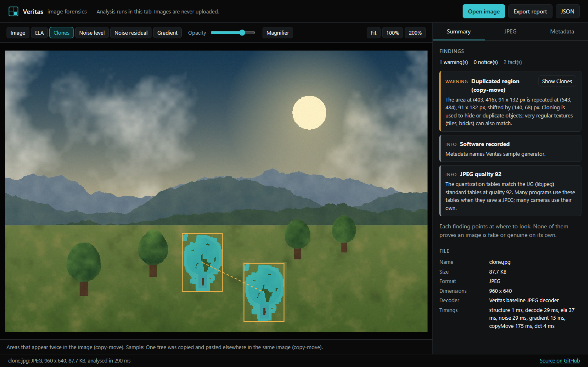

<p align="center"></p>

# Veritas Image Forensics

[](https://github.com/TIENDUNG21/veritas-image-forensics/actions/workflows/ci.yml)
[](LICENSE)

<p align="center"></p>

Veritas reads a JPEG, PNG or WebP file in the browser and shows where it was likely edited:
duplicated regions, areas with a different compression history, error-level and noise
anomalies, and metadata that contradicts the pixels. The file never leaves the tab.



**Live:** https://tiendung21.github.io/veritas-image-forensics/ (five generated samples with
known edits load in one click; `?sample=splice&layer=dct` opens one directly).

The screenshot is the production build analysing `clone.jpg`, a generated landscape in which
one tree was copied 140 px right and 68 px down. Both copies are outlined; the summary quotes
the regions and the shift in file coordinates.

## What it looks at

Every check below runs on the project's own parsers and decoders, in a Web Worker. Each one
reads a specific physical trace, and each has known ways to miss or to mislead.

### JPEG structure and quality

The marker parser lists every segment and the quantization
tables; matching them against the IJG tables scaled for quality 1 to 100 gives the quality
setting of libjpeg-family encoders exactly. Cameras and some editors use their own tables,
which is reported as such rather than forced onto a number.

### Double compression

A JPEG decoded and saved again at a finer quantization step leaves
periodic gaps in the histogram of each DCT coefficient (Popescu and Farid, 2004). Veritas
decodes the Huffman data to quantized coefficients, measures how much of each histogram sits
on the lattice an earlier step would produce, names the earlier quality, and maps per 8x8
block where that lattice is absent (after Lin et al., 2009): a region pasted between the two
saves was compressed once and stands out. It cannot see a second save at the same or lower
quality, or one made after cropping off the 8x8 grid.

### Error level analysis

Content saved once at quality q changes little when saved at q
again; content added afterwards changes more (Krawetz, 2007). Veritas simulates the lossy
part of a JPEG save on luminance (DCT, IJG quantization, IDCT) instead of using the
browser's encoder, so the result is identical in every browser and in the tests. High-contrast
edges and fine texture also light up, which is why hotspots are reported relative to the
image's typical error and only for textured blocks.

### Noise level

The Laplacian-difference kernel of Immerkær (1996) removes most image structure; the remaining
residual is mostly sensor and compression noise. Its level is estimated per block from the
median response, so leftover edges barely move it, and blocks more than twice as noisy or half
as noisy as the rest are grouped into regions. Pasted, blurred or retouched areas often
differ; so do out-of-focus backgrounds and very dark areas.

### Copy-move

Every overlapping 8x8 block gets 16 quantized low-frequency DCT coefficients;
sorting the feature rows puts duplicates side by side, and each matching pair votes for its
shift vector (Fridrich, Soukal and Lukáš, 2003). A cloned region yields thousands of votes for
one shift. The method finds clones moved without rotation or scaling; flat areas are skipped
on purpose, and repetitive textures such as tiles can match legitimately.

### Metadata

EXIF in both byte orders (IFD0, Exif, GPS, Interoperability, IFD1 and its thumbnail), XMP
including the edit history, ICC profile names, PNG and WebP chunks. Findings come from
contradictions: editing software in the history, a modification date days after
capture, EXIF dimensions that differ from the image, and an embedded thumbnail whose content
no longer matches the picture because an editor kept the camera's original.

Findings are graded info, notice or warning, and each one names an innocent explanation.
None is presented as proof. [docs/ARCHITECTURE.md](docs/ARCHITECTURE.md) walks through the
pipeline and every algorithm; [docs/adr](docs/adr) records the four main design decisions.

## Accuracy

Measured by `npm run evaluate` on procedurally generated 768 x 512 landscapes with known
edits, 25 seeds per row ([docs/EVALUATION.md](docs/EVALUATION.md)). These are controlled
synthetic conditions, not photographs; they show how the detectors behave, not how often
they will be right on images found online.

Copy-move: a 64 to 128 px patch of the textured field is copied elsewhere in the field, no
rotation or scaling, and the image is saved once. "Located" means a reported pair overlaps
both the true source and the true target; false alarms are on the untouched images of the
same seeds.

|   Saved at | Located | False alarms |
| ---------: | ------- | ------------ |
| quality 95 | 22 / 25 | 0 / 25       |
| quality 85 | 17 / 25 | 1 / 25       |
| quality 75 | 13 / 25 | 0 / 25       |

Double compression: saved at q1, decoded, saved again at q2 on the same 8x8 grid.

| Saves                          | Detected       | Earlier quality named exactly |
| ------------------------------ | -------------- | ----------------------------- |
| 60, then 90                    | 25 / 25        | 25 / 25                       |
| 80, then 90                    | 25 / 25        | 25 / 25                       |
| 85, then 95                    | 25 / 25        | 25 / 25                       |
| 60, then 80                    | 25 / 25        | 21 / 25 (all within 5)        |
| 90, then 70                    | 0 / 25         | -                             |
| 70, then 90, 3 px crop between | 0 / 25         | -                             |
| saved once at 80, 90 or 95     | 0 / 75 flagged | -                             |

The last three rows are the method's known blind spots and its false-positive check: a
second save at lower quality, or a crop that moves the block grid, removes the comb the test
looks for.

## Performance

Full analysis of one image in Node on the code the worker runs, median of 5 runs, Intel
i7-14700K, 32 GB RAM, Windows 11 ([docs/BENCHMARKS.md](docs/BENCHMARKS.md)):

| Image |   Total | Decode |    ELA | Copy-move |
| ----- | ------: | -----: | -----: | --------: |
| 1 MP  |  341 ms |  38 ms |  53 ms |    197 ms |
| 4 MP  |  766 ms | 115 ms | 177 ms |    301 ms |
| 12 MP | 1789 ms | 339 ms | 521 ms |    417 ms |

Files up to 64 MB and 50 megapixels are accepted; dimensions are checked from the header
before anything is allocated. Pixel analyses run on a copy of at most 16 MP, copy-move on a
copy of at most 1024 px, and the UI says when it downscaled.

## Why it runs in the browser

People check images they would rather not upload: evidence, IDs, private photos. Veritas has
no server. The production page carries a Content-Security-Policy that allows requests to its
own origin only (the app's files and the bundled samples), so the browser itself would block
an upload even if a bug or a dependency tried one. A test scans `src/` and fails on any
network API or URL outside the sample loader, and the build check fails if the policy is
missing. GPS positions are shown as numbers because a map would mean tile requests to a third
party. Exported HTML reports carry their own policy that forbids scripts and network access.
[ADR 0004](docs/adr/0004-no-network-csp-and-static-check.md) has the details.

## Limitations

- **Social-media and messenger images.** Most platforms resize and re-encode uploads with
  their own settings. Resizing moves the 8x8 grid and re-encoding at a lower quality hides
  earlier saves, so double-compression and ELA evidence is mostly gone; on such files the
  absence of findings means little.
- **False positives.** ELA and noise flag strong edges, fine texture, out-of-focus areas and
  dark noise; copy-move can match tiles, fences and other repetition. Treat every region as a
  place to look closely, not a verdict.
- **Not detected.** Rotated, scaled or mirrored clones; colour-only edits (ELA and noise use
  luminance); a second save at the same or lower quality; edits made before the only save;
  regions filled by generative inpainting, which need not leave a compression or noise
  discontinuity.
- **Progressive JPEG** (common on the web), arithmetic-coded, 12-bit and CMYK JPEG are
  decoded by the browser instead, so the DCT analysis is unavailable for them. HEIC and TIFF
  are refused with a message to convert first.
- **Synthetic evaluation.** The accuracy numbers come from generated scenes. There is no
  evaluation on a public forensic dataset yet.

## Usage and building from source

Requires Node.js 22.12 or later.

```sh
git clone https://github.com/TIENDUNG21/veritas-image-forensics.git
cd veritas-image-forensics
npm ci
npm run dev          # http://localhost:5190
npm run build        # dist/, built for https://tiendung21.github.io/veritas-image-forensics/
npm run preview      # serves dist/ under the same sub-path on port 5191
```

In the app: drop, paste or open an image; switch layers with the toolbar or the number keys;
toggle the magnifier with M (it draws the 8x8 grid and the layer value under the cursor);
export the result as a self-contained HTML report or as JSON.

The scripts that produce the numbers above, and the samples, are committed:

```sh
npm run samples      # regenerate public/samples/ (deterministic)
npm run evaluate     # docs/EVALUATION.md
npm run bench        # docs/BENCHMARKS.md
npm run screenshot   # docs/images/hero.png, via headless Edge
```

## Tests

`npm run check` runs ESLint, Prettier, `tsc --checkJs` in strict mode and 197 Vitest tests in
28 files. They include byte-level parser tests, cross-checks of the decoder against
`jpeg-js`, property tests (`fast-check`), fuzzing of the JPEG stack with truncated and
mutated files, detector tests on images with known edits, a test that every bundled sample
produces its advertised finding, HTML-escaping tests for the report and the no-network scan.
CI runs the same checks plus the production build and its sub-path and CSP check.

## Project layout

```
src/core        byte reader, format sniffing, errors, limits, rasters
src/jpeg        parser, Huffman, DCT, decoder, quality, double compression
src/exif        TIFF/EXIF, GPS, XMP, ICC
src/container   JPEG, PNG and WebP metadata readers
src/analysis    ELA, noise, gradient, copy-move, thumbnail comparison
src/findings    findings and their wording
src/pipeline    analyzeImage and the worker protocol
src/worker      worker entry and main-thread client
src/render      colour maps and view geometry
src/report      JSON model and HTML report
src/app         the UI
tools           sample generator, fixture encoders, evaluation, benchmark, screenshot
```

## Roadmap

Keypoint-based copy-move matching for rotated and scaled clones; a progressive JPEG decoder so
DCT analysis covers web images; chroma-plane analyses for colour edits; an evaluation on a
public dataset such as CASIA v2 or Columbia; camera-model quantization table signatures.

## References

- ITU-T Recommendation T.81 (1992). Digital compression and coding of continuous-tone still
  images (JPEG). Annex K quantization and Huffman tables.
- N. Krawetz (2007). A Picture's Worth: Digital Image Analysis and Forensics. Hacker Factor
  Solutions, presented at Black Hat Briefings.
- J. Fridrich, D. Soukal, J. Lukáš (2003). Detection of Copy-Move Forgery in Digital Images.
  Proceedings of the Digital Forensic Research Workshop.
- A. C. Popescu, H. Farid (2004). Statistical Tools for Digital Forensics. Information Hiding,
  LNCS 3200.
- Z. Lin, J. He, X. Tang, C.-K. Tang (2009). Fast, automatic and fine-grained tampered JPEG
  image detection via DCT coefficient analysis. Pattern Recognition 42(11), 2492-2501.
- J. Immerkær (1996). Fast Noise Variance Estimation. Computer Vision and Image
  Understanding 64(2).
- I. Amerini, L. Ballan, R. Caldelli, A. Del Bimbo, G. Serra (2011). A SIFT-Based Forensic
  Method for Copy-Move Attack Detection and Transformation Recovery. IEEE Transactions on
  Information Forensics and Security 6(3).

## Credits and license

All sample images are drawn by `tools/make-samples.mjs`; no third-party images or data are
included. `jpeg-js` (BSD-3-Clause) and `fast-check` (MIT) are used in tests only. Veritas is
released under the [MIT License](LICENSE), copyright 2026 TIENDUNG21.
