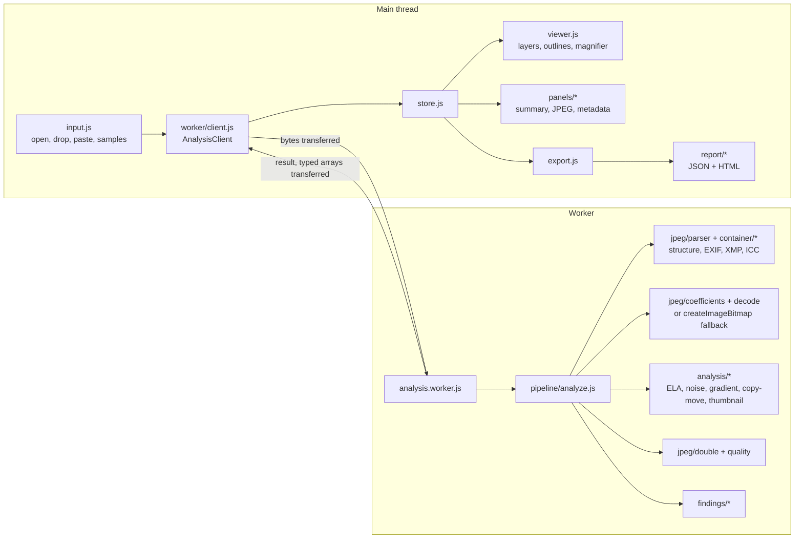

# Architecture

Veritas is a static web app. Everything happens in the browser tab: the file is read with the
File API, transferred to a Web Worker, parsed and decoded there by the project's own code, and
the results come back as plain objects and typed arrays that the main thread draws. There is
no server component and no runtime dependency.

## Layers of the code

| Directory       | Role                                                                                           | DOM?   |
| --------------- | ---------------------------------------------------------------------------------------------- | ------ |
| `src/core`      | byte reader, format sniffing, `ParseError`, limits, raster helpers, region grouping            | no     |
| `src/jpeg`      | marker parser, Huffman decoder, IDCT/FDCT, pixel decoder, quality estimate, double compression | no     |
| `src/exif`      | TIFF IFD walker, tag tables, value formatting, GPS, XMP, ICC                                   | no     |
| `src/container` | per-format metadata readers (JPEG APPn, PNG chunks, WebP RIFF)                                 | no     |
| `src/analysis`  | ELA, JPEG round-trip simulator, noise, gradient, copy-move, thumbnail comparison               | no     |
| `src/findings`  | turns results into ranked findings with neutral wording                                        | no     |
| `src/pipeline`  | `analyzeImage` (orchestration, limits, timings) and the worker message protocol                | no     |
| `src/worker`    | the worker entry and the main-thread client (timeout, cancel, progress)                        | worker |
| `src/render`    | layer colour maps, view geometry, formatting                                                   | no     |
| `src/report`    | report model and self-contained HTML renderer                                                  | no     |
| `src/app`       | UI: store, input, viewer, panels, export                                                       | yes    |

Everything except `src/app` and the worker entry is pure: bytes in, plain data out. That is
why the analyses are tested in Node with Vitest against files whose history is known, and why
the same code runs in the worker unchanged. Types are JSDoc checked by `tsc --noEmit` in
strict mode, with separate configurations for DOM, worker and Node code; ESLint forbids DOM
and network globals in the pure directories.

## One analysis, end to end

1. `input.js` gets a `File` (button, drop, paste) or `samples.js` fetches a bundled sample
   from the app's own origin. The `ArrayBuffer` is transferred, not copied, to a fresh worker.
   The client enforces a 120 s timeout and terminates the worker on cancel, so a pathological
   file cannot hang the tab.
2. `analyzeImage` checks the size limit (64 MB), sniffs the format from magic bytes and parses
   the structure. For JPEG, `parseJpeg` walks every marker segment in tolerant mode: damage
   after the frame header becomes a notice and the remaining analyses still run.
3. Metadata: EXIF (TIFF IFD0, Exif, GPS, Interoperability, IFD1 and its thumbnail), XMP
   (creator tool, dates, document IDs, edit history), ICC profile header and description,
   PNG text chunks and WebP chunks. Every offset is bounds-checked; loops in IFD chains are
   detected.
4. Pixels: the declared dimensions are checked against the 50 MP decode limit before any
   allocation. Baseline JPEG goes through the project's decoder, which also yields the
   quantized coefficient planes (ADR 0001). Other formats and progressive JPEG use
   `createImageBitmap` and `OffscreenCanvas` in the worker.
5. Images above 16 MP are box-downscaled to a working copy; reported regions are converted
   back to full-image pixels before findings are written.
6. The pixel analyses and the DCT analysis run, each timed. Findings are derived and sorted
   most severe first. The result, including typed-array maps, is transferred back.
7. The main thread renders layers lazily (only the one being viewed), and the panels build
   their DOM with `textContent` only, since nearly every string comes from the file.

## The analyses

### JPEG quality estimate

The quantization tables are compared with the IJG (Annex K) tables scaled for each quality
1 to 100. An exact match identifies libjpeg-family encoders and their quality setting; a
large mean difference means the encoder used its own tables, which most cameras and some
editors do. `src/jpeg/quality.js`.

### Double JPEG compression

When a JPEG quantized with step q1 is decoded and saved again with a finer step q2, each
coefficient can only land on bins near round(n * q1 / q2), so its histogram becomes a comb.
For the first 20 AC frequencies (zigzag order) of the luminance, the analysis builds the
histogram of quantized values, fits a smooth single-compression model (a discrete Laplacian)
and measures, for every candidate q1, how much more mass sits on the q1 lattice than the
model predicts. The median score over frequencies decides "saved at least twice"; the
candidates that win per frequency are matched against the IJG tables to name the earlier
quality. For localisation, each 8x8 block gets a naive-Bayes log-likelihood of sharing that
lattice, after Lin et al. (2009): a region pasted between the two saves was compressed once
and stands out. `src/jpeg/double.js`.

### Error level analysis

The image's luminance is re-saved by a pure JPEG round-trip simulation and the absolute
difference is measured per pixel (ADR 0002). The default quality is the file's own IJG
quality when its tables are standard, otherwise 90; the UI can re-run it at any quality in
the worker. Block means are compared with the image's typical block error, skipping flat
blocks; groups of at least four hot blocks become hotspots. If most textured blocks are hot,
the image is called uniform (typical of never-compressed or heavily processed images) instead
of reporting a meaningless hotspot. `src/analysis/ela.js`, `src/analysis/jpegsim.js`.

### Noise level

The luminance is filtered with the kernel [1 -2 1; -2 4 -2; 1 -2 1], which cancels flat
areas, linear ramps and much texture. The 10 % strongest gradients are excluded as edges, and
the noise standard deviation per block (16 px, or 32 px above 4 MP) is estimated from the
median absolute response, which the edges and texture that remain barely move. Groups of blocks
whose noise differs from the image median by more than a factor of 2 either way are reported.
Below a global noise level of 1 the image has been smoothed so much that the map mostly shows
content, and no regions are reported. `src/analysis/noise.js`.

### Copy-move

Overlapping 8x8 blocks on a copy of at most 1024 px, quantized low-frequency DCT features,
lexicographic sort, shift-vector voting (Fridrich, Soukal and Lukas, 2003). See ADR 0003 for
the design and its limits. `src/analysis/copymove.js`.

### Luminance gradient

Sobel gradients shown as colour: horizontal and vertical components in red and green,
magnitude in blue. Not scored; it helps a human see lighting direction, edge sharpness and
smoothed patches. `src/analysis/gradient.js`.

### EXIF thumbnail

Many editors keep the thumbnail the camera wrote. Image and thumbnail are compared as
luminance at thumbnail size in 8x8 cells after removing the global brightness offset; a cell
differing by more than 25 levels means the content changed after the thumbnail was written.
`src/analysis/thumbnail.js`.

## Findings

`src/findings` turns results into short statements with three severities: `info` (a fact,
such as GPS present or a camera model), `notice` (worth a look, such as editing software or
inconsistent dates) and `warning` (a strong local or structural inconsistency, such as a
cloned region or a thumbnail that shows different content). The wording is deliberately
neutral: every finding says where to look and what innocent explanations exist. None of them
is presented as proof.

## Malformed input and resource limits

All parsing goes through a bounds-checked byte reader that throws `ParseError(code, message,
offset)`. The parser, Huffman decoder and pixel decoder are fuzzed with truncation at every
position, random overwrites, inserted and deleted runs, and noise after a valid SOI
(`test/jpeg/fuzz.test.js`); the property is that they either succeed or throw `ParseError`,
within a time bound. Size limits are checked from headers before allocation: dimensions above
50 MP are refused outright, and a file whose entropy-coded data is far too short for the
dimensions it declares (a few hundred bytes claiming 7000 x 7000 pixels) is refused before
the coefficient buffers are allocated.

## Privacy

See ADR 0004. The production page carries a CSP that permits only its own origin, a static
test rejects network APIs in `src/`, and the exported report has its own CSP without scripts.

## Testing

- Unit tests per module with hand-built inputs (byte-exact JPEG segments, TIFF structures
  built by `tools/fixtures/tiff-builder.mjs`, ICC headers).
- Cross-checks against `jpeg-js` as an independent decoder, and property tests with
  `fast-check` (IDCT inverts FDCT, quality estimation recovers every IJG quality, quickselect
  agrees with sorting).
- Detector tests on generated images with known edits, plus `test/samples` asserting that
  every bundled sample produces the finding it advertises and the untouched one stays clean.
- `tools/evaluate.mjs` measures detection and false-alarm rates over many seeds
  (docs/EVALUATION.md); `tools/bench.mjs` measures time per stage (docs/BENCHMARKS.md).
- `tools/screenshot.mjs` drives headless Edge over the DevTools protocol against the
  production build and fails on any page exception or console error.
